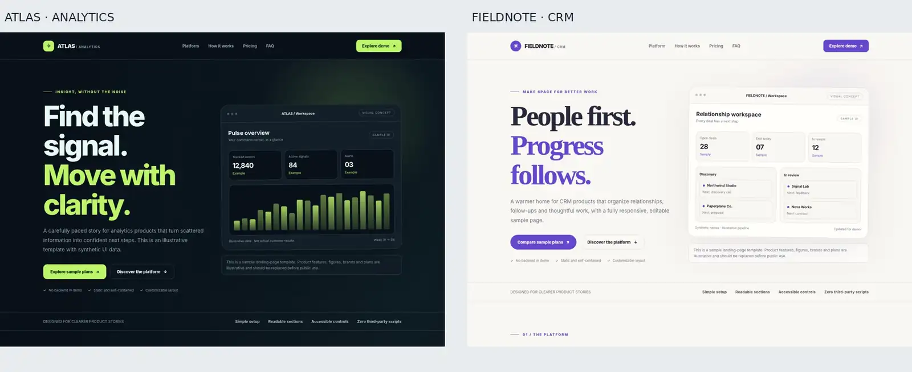

<div align="center">


**Tools for people who build.**

Free developer tools for JSONL / NDJSON validation, `.env` key checks, CSV audits, JSON comparison, UTM link checks, and sensitive staged filenames. Plus reusable AI agent skills and editable SaaS templates.

[**Free tools**](#free-tools) · [**Run the demos**](#try-the-tools-with-bundled-data) · [**Free templates**](#free-templates) · [**Free agent skills**](#free-agent-skills) · [**Discussions**](https://github.com/pauloflp/Agentrix/discussions) · [**Instagram**](https://www.instagram.com/agentrix.tools/)


</div>

---

## Built to solve small, expensive problems

Agentrix is a collection of deliberately focused tools. Start with a problem, choose a tool, and inspect the result. No unnecessary dashboards or accounts for the free CLI utilities.


## FREE TOOLS

All seven microtools below are **free, MIT-licensed**, run locally with **Node.js 20+**, and require **no third-party runtime dependencies**.

| Your problem | Tool | Run a bundled example |
| :--- | :--- | :--- |
| Flag sensitive filenames before a Git commit | **[Staged File Guard](products/agentrix-staged-file-guard/)** | [Path-only staging check →](products/agentrix-staged-file-guard/README.md#try-it) |
| Check a JSONL / NDJSON file for malformed records | **[JSONL Guard](products/agentrix-jsonl-guard/)** | [JSON Lines validator quick start →](products/agentrix-jsonl-guard/README.md#quick-start) |
| Catch missing or undocumented `.env` keys before deployment | **[Env Contract](products/agentrix-env-contract/)** | [Dotenv checker quick start →](products/agentrix-env-contract/README.md#quick-start) |
| Audit CSV column counts, quoting and formula-like cells | **[CSV Guard](products/agentrix-csv-guard/)** | [CSV validator quick start →](products/agentrix-csv-guard/README.md#quick-start) |
| Compare JSON configuration or API response snapshots | **[JSON Diff](products/agentrix-json-diff/)** | [JSON comparison quick start →](products/agentrix-json-diff/README.md#quick-start) |
| Check UTM tags before publishing campaign links | **[UTM Audit](products/agentrix-utm-audit/)** | [Campaign link checker quick start →](products/agentrix-utm-audit/README.md#quick-start) |
| Map CSV columns and export valid rows in a browser | **[Data Import Studio](products/agentrix-data-import-studio/)** | [Load the sample dataset →](products/agentrix-data-import-studio/README.md#get-started) |

### Try the tools with bundled data

With **Git and Node.js 20+**, run the six CLIs against small synthetic files already included in the repository:

```bash
git clone --depth 1 https://github.com/pauloflp/Agentrix.git
cd Agentrix
node scripts/demo.mjs
```

No `npm install`, API key, account or private input file is needed. The demos invoke the actual CLIs and show both successful checks and deliberately invalid inputs. A child command printing `FAIL` with exit `1` is an expected rejection; the demo runner exits `0` only when all 14 examples return their expected exit codes.

Run just one tool with `node scripts/demo.mjs jsonl-guard`, `node scripts/demo.mjs env-contract`, or `node scripts/demo.mjs csv-guard`. The runner also accepts `utm-audit`, `json-diff`, and `staged-file-guard` (using temporary synthetic Git repositories). For the browser-based CSV mapper, follow the [Data Import Studio quick start](products/agentrix-data-import-studio/README.md#get-started).

**[Tutorial: validate JSONL, environment keys and CSV before CI →](docs/local-validation.md)**

### See the ideas behind the tools

These are **original Agentrix campaign illustrations**, not screenshots of the running CLI. The actual commands and sample output are in each product's documentation.

<table>
  <tr>
    <td align="center" width="33%">
      <a href="products/agentrix-env-contract/README.md"></a><br/>
      <strong>Environment keys, aligned.</strong><br/>
      <sub><a href="products/agentrix-env-contract/README.md">Explore Env Contract →</a></sub>
    </td>
    <td align="center" width="33%">
      <a href="products/agentrix-env-contract/README.md"></a><br/>
      <strong>Build smarter with Env Contract.</strong><br/>
      <sub><a href="products/agentrix-env-contract/README.md">See the workflow →</a></sub>
    </td>
    <td align="center" width="33%">
      <a href="skills/"></a><br/>
      <strong>Reusable agent workflows.</strong><br/>
      <sub><a href="skills/">Browse agent skills →</a></sub>
    </td>
  </tr>
</table>

<details>
<summary><strong>Run all seven test suites</strong></summary>

From the repository root:

```bash
(cd products/agentrix-staged-file-guard && npm test)
(cd products/agentrix-env-contract && npm test)
(cd products/agentrix-utm-audit && npm test)
(cd products/agentrix-csv-guard && npm test)
(cd products/agentrix-json-diff && npm test)
(cd products/agentrix-jsonl-guard && npm test)
(cd products/agentrix-data-import-studio && npm test)
```

The [CI workflow](.github/workflows/microproducts-ci.yml) also runs product tests on supported Node.js versions when relevant files change. Passing tests do not guarantee correctness for every possible input.

</details>

## FREE AGENT SKILLS

A curated library of reusable instructions for common technical and creative tasks. **All 15 are free to read and adapt**, subject to applicable licenses and third-party terms.

| Build and engineering | Design and content | Research and operations |
| :--- | :--- | :--- |
| [React code quality](skills/react-code-quality/SKILL.md) | [Creative brief](skills/creative-brief/SKILL.md) | [Research verification](skills/research-verification/SKILL.md) |
| [Premium frontend](skills/premium-frontend/SKILL.md) | [Motion direction](skills/motion-direction/SKILL.md) | [Data provenance](skills/data-provenance/SKILL.md) |
| [Remotion engineering](skills/remotion-engineering/SKILL.md) | [Brand guardian](skills/brand-guardian/SKILL.md) | [Context retrieval](skills/context-retrieval/SKILL.md) |
| [QA release gate](skills/qa-release-gate/SKILL.md) | [Commercial copy](skills/commercial-copy/SKILL.md) | [Memory governance](skills/memory-governance/SKILL.md) |
| [Dashboard intelligence](skills/dashboard-intelligence/SKILL.md) | [AI video handoff](skills/ai-video-handoff/SKILL.md) | [Workflow orchestration](skills/workflow-orchestration/SKILL.md) |

**[Explore the full index](skills/index.json)** · **[Choose a skill with the routing guide](SKILL_ROUTER.md)**

> These are instruction files, not automatically installed plugins or a promise of increased model capabilities. Open the relevant `SKILL.md`, adapt it to your compatible agent, and review the output.

## FREE TEMPLATES

### Agentrix SaaS Landing Kit · FREE DOWNLOAD

**Two complete editable SaaS landing pages: Atlas Analytics and Fieldnote CRM.** Download and customize the HTML/CSS/JavaScript for personal or commercial websites with no checkout, login, password, or payment. These are **frontend templates**, not a working SaaS backend.

[](premium/agentrix-saas-landing-kit/README.md)

**[Download the ZIP (no password) →](premium/agentrix-saas-landing-kit/AGENTRIX_SaaS_Landing_Kit_FREE_v1.0.zip)** · [Explore the templates →](premium/agentrix-saas-landing-kit/README.md) · [Free-use license →](premium/agentrix-saas-landing-kit/LICENSE.txt)

The kit is free to use for your own and client projects. Redistributing the unmodified pack as a competing template product is not permitted. This **source-available** license is separate from the MIT licenses of the seven free microtools.

## PREMIUM TEMPLATES

No premium template is currently available to purchase. The SaaS Landing Kit has been released as a **free product** rather than a paid preview. This does not change the status of any other Agentrix product.

## PREMIUM TOOLS

Premium products are separate, optional offers. Each product has its own scope, availability, and delivery details. **A product described as a preview is not available for purchase.**

### Campaign QA Pro · US$29 one-time

Campaign QA Pro is a local browser-based tool for bulk campaign-link checks, CSV imports, configurable UTM naming allowlists, and downloadable QA reports. It does **not** replace or restrict the free UTM Audit CLI.

**[Buy Campaign QA Pro — US$29 one-time →](https://buy.stripe.com/9B69AT928eYX5264GfgjC01)** Open the encrypted HTTPS workspace in desktop Chrome and unlock it with your purchase key. See the product page for verified features, limits, and testing scope.

[**View Campaign QA Pro scope and limitations →**](premium/agentrix-campaign-qa/README.md)

---

## Principles

- **Useful over complicated.** Each tool targets a specific workflow.
- **Honest by design.** Read the limitations and inspect results before making decisions.
- **Local first where practical.** The free CLIs do not upload your files.
- **Free stays free.** The seven MIT microtools and 15 agent skills are not locked behind the premium checkout.

### Revenue Tools · private development previews

Revenue Reconcile compares expected receivables with settled receipts and flags missing payments, possible duplicates and amount/fee differences. Revenue Pulse audits recurring-revenue movements, churn and overdue invoice balances. Both are paid-first offline previews using fictional CSV datasets; they are **not available for purchase**. No bank connection or automated collection is included.

## Community & Roadmap

Agentrix is built around practical problems, reproducible examples, and useful feedback, not follower farming.

- **[Help choose the next developer tool →](https://github.com/pauloflp/Agentrix/issues/12)** — a public roadmap issue asking for concrete workflows and product suggestions.
- **[Ask a usage question or share a workflow →](https://github.com/pauloflp/Agentrix/discussions)** — technical discussions about the tools and reproducible examples.
- **[Report a reproducible bug →](https://github.com/pauloflp/Agentrix/issues/new/choose)** — include the affected tool, expected result and sanitized steps.
- **[Suggest a feature →](https://github.com/pauloflp/Agentrix/issues/new/choose)** — explain your specific task and why existing solutions are insufficient.
- **[Read the contribution guidelines →](CONTRIBUTING.md)** — scope, code quality, licensing, and respectful participation.
- **[Community standards →](CODE_OF_CONDUCT.md)** · **[Security reporting →](SECURITY.md)** · **[Component licenses →](LICENSE.md)** — participation rules, private vulnerability reporting and precise licensing.

Feedback is welcome even if you don't write code. Product release notes live in the repository, and public discussion should stay relevant to the people using these tools.

## Follow the build

[Instagram @agentrix.tools](https://www.instagram.com/agentrix.tools/) · [GitHub repository](https://github.com/pauloflp/Agentrix) · [Issues](https://github.com/pauloflp/Agentrix/issues)

Questions, bug reports, and thoughtful contributions are welcome. Please do not share credentials, private client data, or payment unlock keys in public issues.

<sub>Agentrix is an independent project, not officially affiliated with the third-party platforms mentioned in its documentation. Campaign illustrations are promotional artwork, not software screenshots.</sub>
