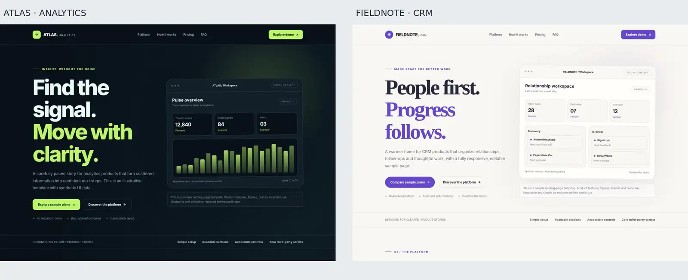

<div align="center">


**Local tools for developers, finance teams, and retail operations.**

Validate data before import, find gaps in campaign tracking, and review business exports with focused tools and reproducible examples.

[**What's new**](#whats-new) · [**Free tools**](#free-tools) · [**Paid tools**](#paid-tools) · [**Free templates**](#free-templates) · [**Free agent skills**](#free-agent-skills) · [**Release history**](https://github.com/pauloflp/Agentrix/releases)


</div>

---

## What's new

**November 6, 2026.** Nine paid tools joined the catalog, including five new CSV checks for purchasing, supplier changes, coupons, and invoices.

| Latest release | What it checks |
| --- | --- |
| [Purchase Order Quantity Variance Audit](https://github.com/pauloflp/Agentrix/releases/tag/purchase-order-quantity-variance-audit-v0.1.0) | Compare ordered and received quantities by order and SKU |
| [Supplier Bank Detail Change Check](https://github.com/pauloflp/Agentrix/releases/tag/supplier-bank-detail-change-check-v0.1.0) | Review changes to supplier bank details between two exports |
| [Coupon Redemption Cap Check](https://github.com/pauloflp/Agentrix/releases/tag/coupon-redemption-cap-check-v0.1.0) | Find coupons whose recorded redemptions exceed their cap |
| [Invoice Date Order Check](https://github.com/pauloflp/Agentrix/releases/tag/invoice-date-order-check-v0.1.0) | Find invoice due dates earlier than their issue dates |
| [Invoice Line Arithmetic Check](https://github.com/pauloflp/Agentrix/releases/tag/invoice-line-arithmetic-check-v0.1.0) | Find invoice line totals that disagree with quantity and unit price |

[Read the November 6 release roundup](https://github.com/pauloflp/Agentrix/releases/tag/catalog-update-v2026.11.6) · [Browse all releases](https://github.com/pauloflp/Agentrix/releases)

## Free tools

**Nine MIT-licensed tools.** Run them locally without a purchase. The free SaaS Landing Kit and agent skills are listed below.

| Tool | What it does | Get started |
| --- | --- | --- |
| **[Staged File Guard](products/agentrix-staged-file-guard/)** | Check for private-looking files before publishing code | [Path-only staging check →](products/agentrix-staged-file-guard/README.md#try-it) · [Release](https://github.com/pauloflp/Agentrix/releases/tag/staged-file-guard-v1.0.0) |
| **[JSONL Guard](products/agentrix-jsonl-guard/)** | Find broken records in a data export or AI file | [JSON Lines validator quick start →](products/agentrix-jsonl-guard/README.md#quick-start) · [Release](https://github.com/pauloflp/Agentrix/releases/tag/jsonl-guard-v1.0.0) |
| **[Env Contract](products/agentrix-env-contract/)** | Spot missing app settings before launch | [Dotenv checker quick start →](products/agentrix-env-contract/README.md#quick-start) · [Release](https://github.com/pauloflp/Agentrix/releases/tag/env-contract-v0.1.0) |
| **[CSV Guard](products/agentrix-csv-guard/)** | Catch CSV formatting mistakes before importing data | [CSV validator quick start →](products/agentrix-csv-guard/README.md#quick-start) · [Release](https://github.com/pauloflp/Agentrix/releases/tag/csv-guard-v1.0.0) |
| **[JSON Diff](products/agentrix-json-diff/)** | See what changed between two configuration files | [JSON comparison quick start →](products/agentrix-json-diff/README.md#quick-start) · [Release](https://github.com/pauloflp/Agentrix/releases/tag/json-diff-v0.1.0) |
| **[Webhook Delivery Inspector](products/agentrix-webhook-delivery-inspector/)** | Diagnose repeated failures and retries in webhook delivery logs | [Webhook demo →](products/agentrix-webhook-delivery-inspector/README.md#run) · [Release](https://github.com/pauloflp/Agentrix/releases/tag/webhook-delivery-inspector-v1.0.0) |
| **[Output Contract](products/agentrix-output-contract/)** | Validate agent JSON outputs against a simple contract | [Contract check quick start →](products/agentrix-output-contract/README.md#quick-start) · [Release](https://github.com/pauloflp/Agentrix/releases/tag/output-contract-v1.0.0) |
| **[UTM Audit](products/agentrix-utm-audit/)** | Find tracking mistakes in your advertising links | [Campaign link checker quick start →](products/agentrix-utm-audit/README.md#quick-start) · [Release](https://github.com/pauloflp/Agentrix/releases/tag/utm-audit-v0.1.0) |
| **[Data Import Studio](products/agentrix-data-import-studio/)** | Prepare spreadsheet exports for another system | [Load the sample dataset →](products/agentrix-data-import-studio/README.md#get-started) · [Release](https://github.com/pauloflp/Agentrix/releases/tag/data-import-studio-v1.0.0) |

## Paid tools

**12 tools available as one-time purchases.** Each product guide explains requirements, includes an example, and shows how to get access.

| Tool | What it does | Price and access |
| --- | --- | --- |
| **[Campaign QA Pro](premium/agentrix-campaign-qa/README.md)** | Check many advertising links for missing UTM tags and inconsistent tracking names before launching a campaign | **US$29** · [Buy](https://buy.stripe.com/9B69AT928eYX5264GfgjC01) · [Release](https://github.com/pauloflp/Agentrix/releases/tag/campaign-qa-pro-v1.1.0) |
| **[Revenue Reconcile](premium/revenue-tools/reconcile.md)** | Find payments that are missing, duplicated, or different from what your business expected to receive | **US$149** · [Buy](https://buy.stripe.com/28EbJ17Y4g31gKOgoXgjC04) · [Release](https://github.com/pauloflp/Agentrix/releases/tag/revenue-reconcile-v0.1.1) |
| **[Revenue Pulse](premium/revenue-tools/pulse.md)** | Understand recurring revenue, cancellations, and overdue invoices from your subscription records | **US$99** · [Buy](https://buy.stripe.com/7sY7sLems3gf5260pZgjC05) · [Release](https://github.com/pauloflp/Agentrix/releases/tag/revenue-pulse-v0.1.1) |
| **[SaaS Margin Leak](premium/agentrix-saas-margin-leak/README.md)** | Find customers or plans with low contribution margins | **US$49** · [Buy](https://buy.stripe.com/3cI28r6U01871PU7SrgjC06) · [Release](https://github.com/pauloflp/Agentrix/releases/tag/saas-margin-leak-v0.1.0) |
| **[Refund Overpayment Audit](premium/agentrix-refund-overpayment-audit/README.md)** | Find orders where recorded refunds exceed the amount paid | **R$79** · [Buy](https://buy.stripe.com/5kQ28ra6c8Az1PU4GfgjC07) · [Release](https://github.com/pauloflp/Agentrix/releases/tag/refund-overpayment-audit-v0.1.0) |
| **[Supplier Invoice Duplicate Check](premium/agentrix-supplier-invoice-duplicate-check/README.md)** | Find repeated supplier invoice references before import | **US$29** · [Buy](https://buy.stripe.com/6oU9AT7Y4aIHbqu5KjgjC08) · [Release](https://github.com/pauloflp/Agentrix/releases/tag/supplier-invoice-duplicate-check-v0.1.0) |
| **[Retail SKU Price Floor Audit](premium/agentrix-retail-sku-price-floor-audit/README.md)** | Find retail SKUs below a target gross margin after channel fees | **R$79** · [Buy](https://buy.stripe.com/6oUfZhemsg3166a0pZgjC09) · [Release](https://github.com/pauloflp/Agentrix/releases/tag/retail-sku-price-floor-audit-v0.1.0) |
| **[Purchase Order Quantity Variance Audit](premium/agentrix-purchase-order-quantity-variance-audit/README.md)** | Compare ordered and received quantities by order and SKU | **US$29** · [Buy](https://buy.stripe.com/9B6aEX7Y40431PUgoXgjC0a) · [Release](https://github.com/pauloflp/Agentrix/releases/tag/purchase-order-quantity-variance-audit-v0.1.0) |
| **[Supplier Bank Detail Change Check](premium/agentrix-supplier-bank-detail-change-check/README.md)** | Review changes to supplier bank details between two exports | **US$29** · [Buy](https://buy.stripe.com/cNi3cv5PW6srgKOfkTgjC0c) · [Release](https://github.com/pauloflp/Agentrix/releases/tag/supplier-bank-detail-change-check-v0.1.0) |
| **[Coupon Redemption Cap Check](premium/agentrix-coupon-redemption-cap-check/README.md)** | Find coupons whose recorded redemptions exceed their cap | **R$79** · [Buy](https://buy.stripe.com/8x26oH7Y43gf9imdcLgjC0d) · [Release](https://github.com/pauloflp/Agentrix/releases/tag/coupon-redemption-cap-check-v0.1.0) |
| **[Invoice Date Order Check](premium/agentrix-invoice-date-order-check/README.md)** | Find invoice due dates earlier than their issue dates | **US$19** · [Buy](https://buy.stripe.com/dRm4gz4LS8Az0LQ1u3gjC0e) · [Release](https://github.com/pauloflp/Agentrix/releases/tag/invoice-date-order-check-v0.1.0) |
| **[Invoice Line Arithmetic Check](premium/agentrix-invoice-line-arithmetic-check/README.md)** | Find invoice line totals that disagree with quantity and unit price | **US$19** · [Buy](https://buy.stripe.com/8x24gz6U06sr526goXgjC0b) · [Release](https://github.com/pauloflp/Agentrix/releases/tag/invoice-line-arithmetic-check-v0.1.0) |

[Find a tool by task](docs/find-a-tool.md) · [Component licenses](LICENSE.md) · [Run the free demos](#try-the-tools-with-bundled-data)

## Free agent skills

A curated library of reusable instructions for common technical and creative tasks. **All 15 are free to read and adapt**, subject to applicable licenses and third-party terms.

| Build and engineering | Design and content | Research and operations |
| :--- | :--- | :--- |
| [React code quality](skills/react-code-quality/SKILL.md) | [Creative brief](skills/creative-brief/SKILL.md) | [Research verification](skills/research-verification/SKILL.md) |
| [Premium frontend](skills/premium-frontend/SKILL.md) | [Motion direction](skills/motion-direction/SKILL.md) | [Data provenance](skills/data-provenance/SKILL.md) |
| [Remotion engineering](skills/remotion-engineering/SKILL.md) | [Brand guardian](skills/brand-guardian/SKILL.md) | [Context retrieval](skills/context-retrieval/SKILL.md) |
| [QA release gate](skills/qa-release-gate/SKILL.md) | [Commercial copy](skills/commercial-copy/SKILL.md) | [Memory governance](skills/memory-governance/SKILL.md) |
| [Dashboard intelligence](skills/dashboard-intelligence/SKILL.md) | [AI video handoff](skills/ai-video-handoff/SKILL.md) | [Workflow orchestration](skills/workflow-orchestration/SKILL.md) |

**[Explore the full index](skills/index.json)** · **[Choose a skill with the routing guide](SKILL_ROUTER.md)**

> These are instruction files, not automatically installed plugins or a promise of increased model capabilities. Open the relevant `SKILL.md`, adapt it to your compatible agent, and review the output.

## Free templates

### Agentrix SaaS Landing Kit · FREE DOWNLOAD

**Two complete editable SaaS landing pages: Atlas Analytics and Fieldnote CRM.** Download and customize the HTML/CSS/JavaScript for personal or commercial websites with no checkout, login, password, or payment. These are **frontend templates**, not a working SaaS backend.

[](premium/agentrix-saas-landing-kit/README.md)

**[Download the ZIP (no password) →](premium/agentrix-saas-landing-kit/AGENTRIX_SaaS_Landing_Kit_FREE_v1.0.zip)** · [Explore the templates →](premium/agentrix-saas-landing-kit/README.md) · [Free-use license →](premium/agentrix-saas-landing-kit/LICENSE.txt)

The kit is free to use for your own and client projects. Redistributing the unmodified pack as a competing template product is not permitted. This **source-available** license is separate from the MIT licenses of the nine free microtools.

## Demos and test suites

### Try the tools with bundled data

With **Git and Node.js 20+**, run the eight CLIs against small synthetic files already included in the repository:

```bash
git clone --depth 1 https://github.com/pauloflp/Agentrix.git
cd Agentrix
node scripts/demo.mjs
```

No `npm install`, API key, account or private input file is needed. The demos invoke the actual CLIs and show both successful checks and deliberately invalid inputs. A child command printing `FAIL` with exit `1` is an expected rejection; the demo runner exits `0` only when all 18 examples return their expected exit codes.

Run just one tool with `node scripts/demo.mjs jsonl-guard`, `node scripts/demo.mjs env-contract`, or `node scripts/demo.mjs csv-guard`. The runner also accepts `utm-audit`, `json-diff`, and `staged-file-guard` (using temporary synthetic Git repositories). For the browser-based CSV mapper, follow the [Data Import Studio quick start](products/agentrix-data-import-studio/README.md#get-started).

**[Tutorial: validate JSONL, environment keys and CSV before CI →](docs/local-validation.md)**

### What the tools help you solve

A visual introduction to the problems Agentrix tools are designed to solve. These are promotional illustrations. Explore each tool's documentation for real examples, commands and capabilities.

<table>
  <tr>
    <td align="center" width="33%">
      <a href="products/agentrix-env-contract/README.md"></a><br/>
      <strong>Environment keys, aligned.</strong><br/>
      <sub><a href="products/agentrix-env-contract/README.md">Explore Env Contract →</a></sub>
    </td>
    <td align="center" width="33%">
      <a href="products/agentrix-env-contract/README.md"></a><br/>
      <strong>Build smarter with Env Contract.</strong><br/>
      <sub><a href="products/agentrix-env-contract/README.md">See the workflow →</a></sub>
    </td>
    <td align="center" width="33%">
      <a href="skills/"></a><br/>
      <strong>Reusable agent workflows.</strong><br/>
      <sub><a href="skills/">Browse agent skills →</a></sub>
    </td>
  </tr>
</table>

<details>
<summary><strong>Run all nine test suites</strong></summary>

From the repository root:

```bash
(cd products/agentrix-staged-file-guard && npm test)
(cd products/agentrix-env-contract && npm test)
(cd products/agentrix-utm-audit && npm test)
(cd products/agentrix-csv-guard && npm test)
(cd products/agentrix-json-diff && npm test)
(cd products/agentrix-jsonl-guard && npm test)
(cd products/agentrix-output-contract && npm test)
(cd products/agentrix-webhook-delivery-inspector && npm test)
(cd products/agentrix-data-import-studio && npm test)
```

The [CI workflow](.github/workflows/microproducts-ci.yml) also runs product tests on supported Node.js versions when relevant files change. Passing tests do not guarantee correctness for every possible input.

</details>

## Principles

- **Useful over complicated.** Each tool targets a specific workflow.
- **Honest by design.** Read the limitations and inspect results before making decisions.
- **Local first where practical.** The free CLIs do not upload your files.
- **Free stays free.** The nine MIT microtools and 15 agent skills are not locked behind the premium checkout.

## Community & Roadmap

Agentrix is built around practical problems, reproducible examples, and useful feedback, not follower farming.

- **[Help choose the next developer tool →](https://github.com/pauloflp/Agentrix/issues/12)** — a public roadmap issue asking for concrete workflows and product suggestions.
- **[Ask a usage question or share a workflow →](https://github.com/pauloflp/Agentrix/discussions)** — technical discussions about the tools and reproducible examples.
- **[Report a reproducible bug →](https://github.com/pauloflp/Agentrix/issues/new/choose)** — include the affected tool, expected result and sanitized steps.
- **[Suggest a feature →](https://github.com/pauloflp/Agentrix/issues/new/choose)** — explain your specific task and why existing solutions are insufficient.
- **[Read the contribution guidelines →](CONTRIBUTING.md)** — scope, code quality, licensing, and respectful participation.
- **[Community standards →](CODE_OF_CONDUCT.md)** · **[Security reporting →](SECURITY.md)** · **[Component licenses →](LICENSE.md)** — participation rules, private vulnerability reporting and precise licensing.

Feedback is welcome even if you don't write code. Product release notes live in the repository, and public discussion should stay relevant to the people using these tools.

## Follow the build

[Instagram @agentrix.tools](https://www.instagram.com/agentrix.tools/) · [GitHub repository](https://github.com/pauloflp/Agentrix) · [Issues](https://github.com/pauloflp/Agentrix/issues)

Questions, bug reports, and thoughtful contributions are welcome. Please do not share credentials, private client data, or payment unlock keys in public issues.

<sub>Agentrix is an independent project, not officially affiliated with the third-party platforms mentioned in its documentation. Campaign illustrations are promotional artwork, not software screenshots.</sub>
