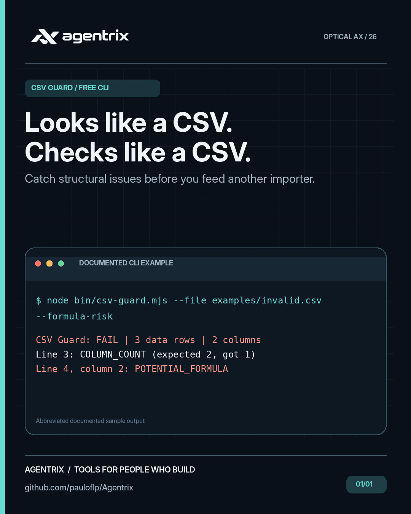
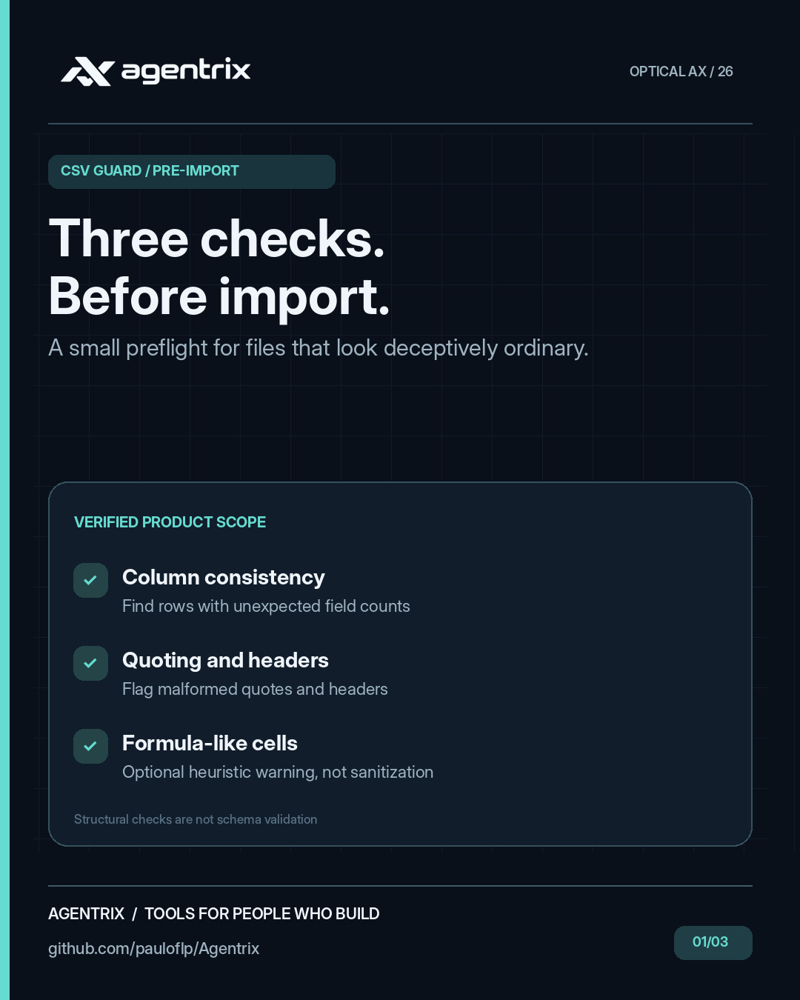
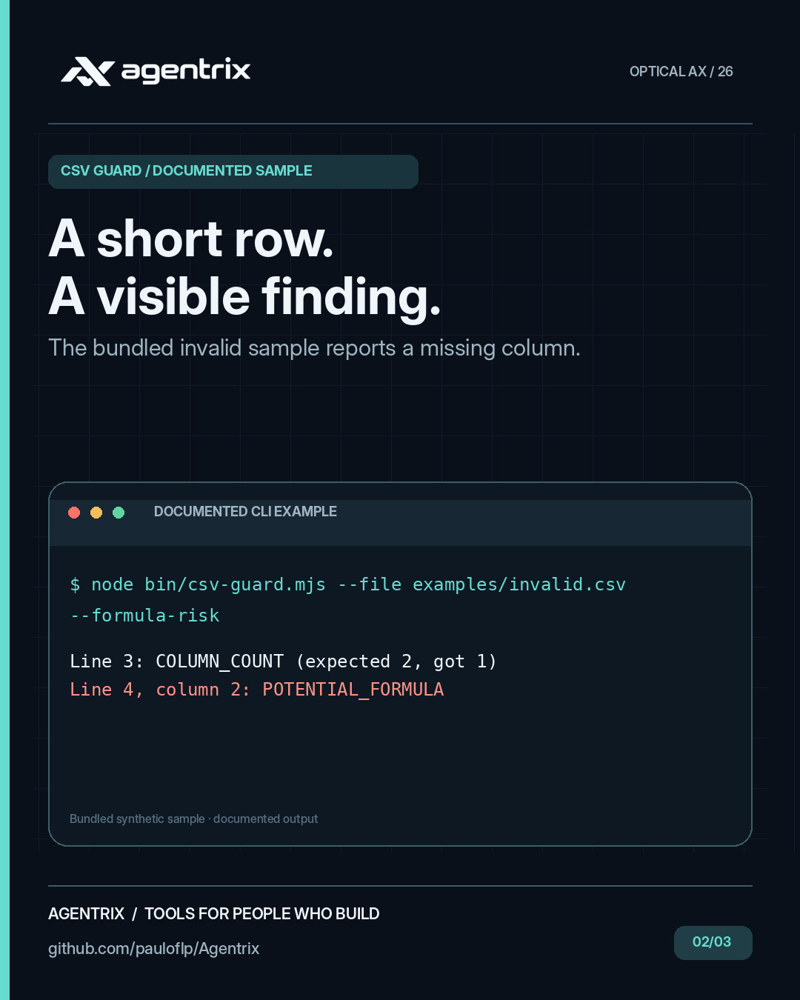
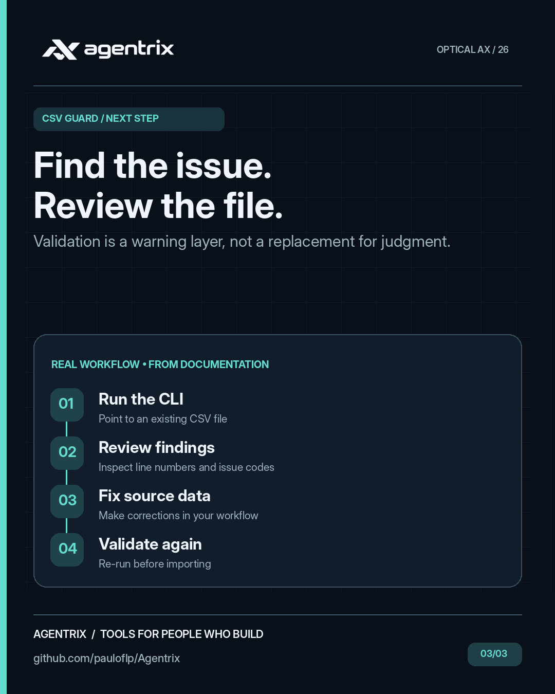

# Agentrix CSV Guard: CSV structure validator

**In plain English:** Catch formatting mistakes in CSV files before importing business data. It checks whether rows and columns are consistent, and can warn about potential spreadsheet formula risks.

**Example:** A product export has a row with a missing column. CSV Guard tells you where to look before you import the file into another system.

**Find inconsistent CSV columns, malformed quotes and formula-like cells before an import.** A free, offline CSV validator and structure checker for Node.js 20+, with zero runtime dependencies. Formula-risk detection is opt-in and does not sanitize the file.

## CSV Guard at a glance

These campaign illustrations highlight the kinds of problems **CSV Guard** helps address. They are conceptual visuals rather than product screenshots. Follow the examples and documentation below to see what the tool actually does.

<p align="center"></p>

<details>
<summary>View 3 more campaign images</summary>

<p align="center">



</p>

</details>

## Quick start

Requires **Git and Node.js 20+**. Run the bundled synthetic files without installing packages:

```bash
git clone --depth 1 https://github.com/pauloflp/Agentrix.git
cd Agentrix/products/agentrix-csv-guard
node bin/csv-guard.mjs --file examples/valid.csv
```

```text
CSV Guard: PASS | 2 data rows | 2 columns | delimiter: comma
```

The [invalid sample](examples/invalid.csv) contains a short row and a formula-like cell:

```csv
name,email
Morgan,morgan@example.com
Riley
Casey,=1+1
```

```bash
node bin/csv-guard.mjs --file examples/invalid.csv --formula-risk
```

```text
CSV Guard: FAIL | 3 data rows | 2 columns | delimiter: comma
Line 3: COLUMN_COUNT (expected 2, got 1)
Line 4, column 2: POTENTIAL_FORMULA
```

This rejection intentionally exits `1`. The sample formula is only text until opened in spreadsheet software. From the repository root, `node scripts/demo.mjs csv-guard` runs both cases and checks their expected exit codes.

<div align="center">

<br/><sub>Agentrix workflow illustration. Commands and limitations below describe this specific tool.</sub>
</div>

## Usage

Run from the product directory with **your own existing file**:

```bash
node bin/csv-guard.mjs --file ./data.csv
node bin/csv-guard.mjs --file ./data.csv --delimiter semicolon --json
node bin/csv-guard.mjs --file ./data.csv --no-header --formula-risk
npm test
```

`--json` returns a machine-readable report. `--delimiter` accepts `auto` (default), `comma`, `semicolon`, `tab` or `pipe`. `--no-header` treats the first row as data. `--formula-risk` flags cells starting with formula-like characters, including after leading whitespace; benign negative numbers can also be flagged. `--help` prints usage.

Detects inconsistent column counts, malformed quotes, empty/duplicate headers, blank rows, and optionally formula-like spreadsheet cells. Supports BOM, quoted multiline fields, CRLF and comma, semicolon, tab and pipe delimiters. Exit codes: 0 clean, 1 issues, 2 input/usage error. The JSON report contains counts and issue locations, not cell contents. Files are read locally; no upload or telemetry. Maximum file size: 10 MiB. Delimiter autodetection is heuristic; override it if needed. Formula detection is a warning heuristic, not sanitization; do not open untrusted CSVs in spreadsheet software without appropriate safeguards.

MIT licensed. Not a replacement for schema or data validation.

## Related tools

Use [Data Import Studio](../agentrix-data-import-studio/) for visual column mapping, typed fields and clean/error exports. Use [JSONL Guard](../agentrix-jsonl-guard/) when the input is newline-delimited JSON. [Follow the local validation tutorial](../../docs/local-validation.md) or [browse all six tools](../../README.md#free-tools).
