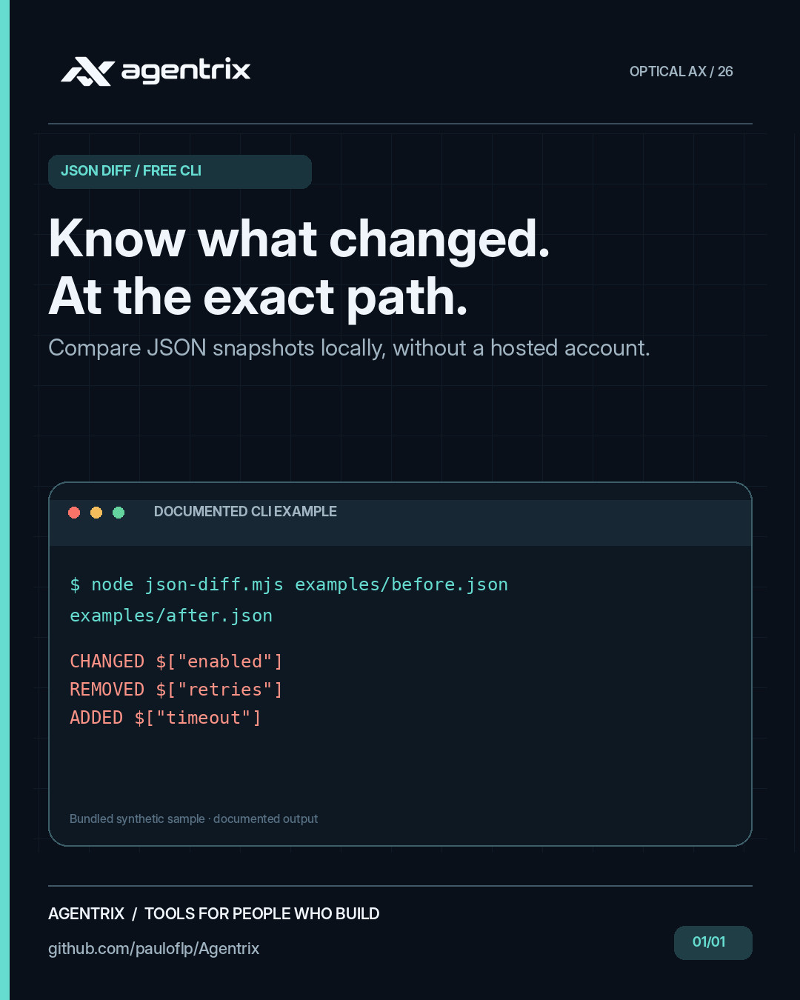

# Agentrix JSON Diff: compare JSON files by path

**In plain English:** See what changed between two versions of a configuration file. It compares JSON files and points to settings that were added, removed or changed.

**Example:** Something behaves differently after a configuration update. Compare the old and new files to locate the changes before investigating further.

Free, offline, zero-dependency Node.js 20+ CLI comparing JSON documents. Reports added, removed, and changed values with precise paths. Object property order is ignored; array elements are compared by index.

## JSON Diff at a glance

These campaign illustrations highlight the kinds of problems **JSON Diff** helps address. They are conceptual visuals rather than product screenshots. Follow the examples and documentation below to see what the tool actually does.

<p align="center"></p>

## Quick start

Requires **Git and Node.js 20+**; no `npm install` is needed:

```bash
git clone --depth 1 https://github.com/pauloflp/Agentrix.git
cd Agentrix/products/agentrix-json-diff
node json-diff.mjs examples/before.json examples/after.json
```

The bundled [before](examples/before.json) and [after](examples/after.json) files differ in three keys:

```text
CHANGED $["enabled"]
REMOVED $["retries"]
ADDED $["timeout"]
```

Differences intentionally exit `1`; comparing `examples/before.json` with itself prints `No differences.` and exits `0`. From the repository root, `node scripts/demo.mjs json-diff` demonstrates both outcomes.

<div align="center">

<br/><sub>Agentrix workflow illustration. Commands and limitations below describe this specific tool.</sub>
</div>

## Usage

```bash
node json-diff.mjs before.json after.json
node json-diff.mjs --json before.json after.json
npm test
```

Exit codes: `0` equal, `1` differences, `2` invalid input or read error.

Paths use `$["property"]` for object keys and `$[0]` for array indices. Text output shows paths only. **The `--json` option includes original values**, which may contain secrets; don't share it publicly without review.

Not a JSON Schema validator. Arrays are index-based; input files must fit in memory. No network, telemetry, or external packages.

MIT licensed.

## Related tools

[JSONL Guard](../agentrix-jsonl-guard/) checks the syntax of one JSON value per line. [Env Contract](../agentrix-env-contract/) compares `.env` key names without printing their values. [Browse all six tools](../../README.md#free-tools) or [ask a usage question](https://github.com/pauloflp/Agentrix/discussions).
