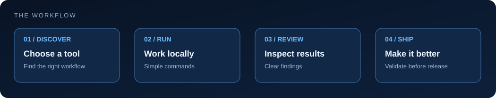

# Agentrix JSON Diff

Free, offline, zero-dependency Node.js 20+ CLI comparing JSON documents. Reports added, removed, and changed values with precise paths. Object property order is ignored; array elements are compared by index.

<div align="center">

<br/><sub>Agentrix workflow illustration. Commands and limitations below describe this specific tool.</sub>
</div>

## Usage

```bash
node json-diff.mjs before.json after.json
node json-diff.mjs --json before.json after.json
npm test
```

Exit codes: `0` equal, `1` differences, `2` invalid input or read error.

Paths use `$["property"]` for object keys and `$[0]` for array indices. Text output shows paths only. **The `--json` option includes original values**, which may contain secrets; don't share it publicly without review.

Not a JSON Schema validator. Arrays are index-based; input files must fit in memory. No network, telemetry, or external packages.

MIT licensed.
