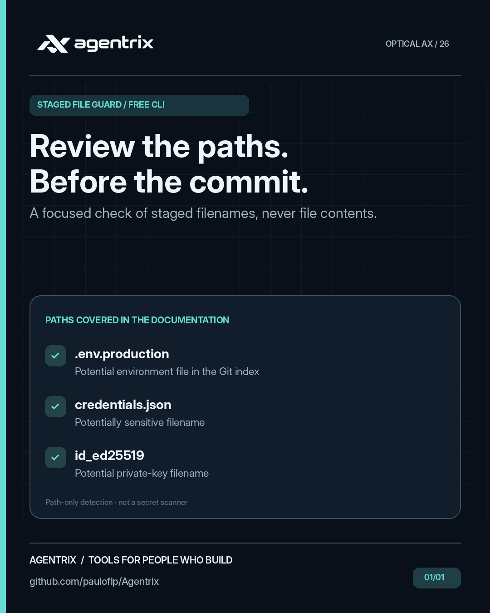
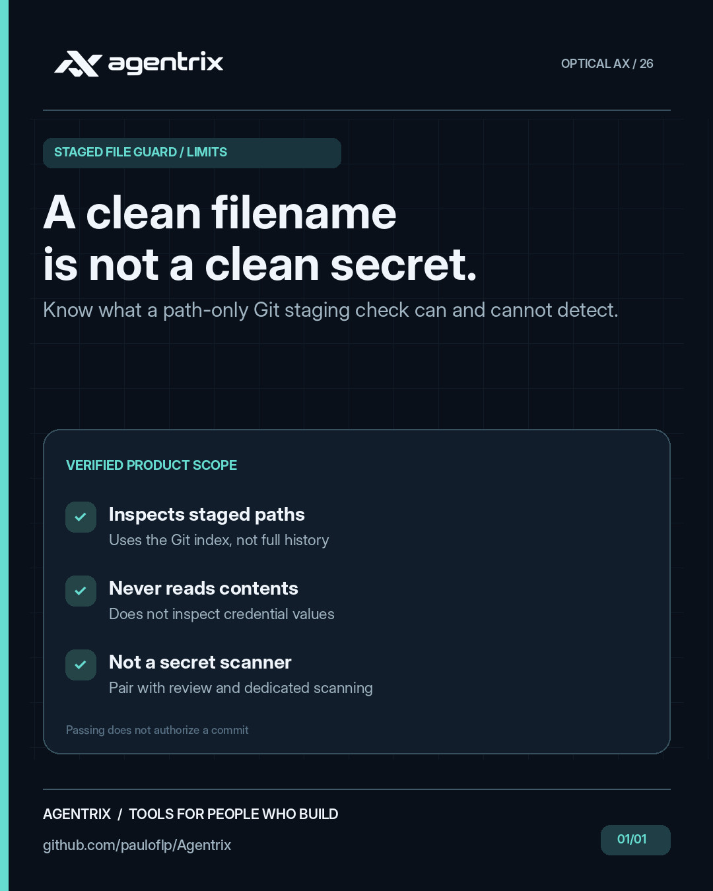

# Agentrix Staged File Guard

**In plain English:** Before publishing code, check whether the changes you prepared include files that may contain private settings or keys. The tool warns you based on filenames, not file contents.

**Example:** You accidentally prepare a file named `.env.production` for a commit. Staged File Guard flags its name so you can review it before publishing.

A dependency-free Node.js 20+ CLI that flags **potentially sensitive file paths in Git's staging area** before a commit. It inspects **file names only**, never file contents, credential values or network resources.

## Staged File Guard at a glance

These campaign illustrations highlight the kinds of problems **Staged File Guard** helps address. They are conceptual visuals rather than product screenshots. Follow the examples and documentation below to see what the tool actually does.

<p align="center"></p>

<details>
<summary>View 1 more campaign image</summary>

<p align="center">

</p>

</details>

## Try it

```bash
node src/cli.js --help
node src/cli.js --cwd /path/to/your/repo
node src/cli.js --cwd /path/to/your/repo --json
npm test
```

Exit codes: `0` no suspicious paths; `1` suspicious paths; `2` invalid arguments or Git failure. JSON output contains `ok`, `count` and `findings` (`path`, `reason`), or an `error` on failure.

## What it flags

Examples include `.env`, `.env.production`, `.npmrc`, `.pypirc`, `id_rsa`, `id_ed25519`, `.pem`, `.key`, `.p12`, `.pfx`, `.jks`, `.keystore`, `.kdbx`, `credentials.json`, `secrets.json`, and `service_account_prod.json`. Common `.env.example`, `.env.sample`, `.env.template` and `credentials.example.json` templates are excluded to reduce obvious false positives.

Uses `git diff --cached --name-only -z --diff-filter=ACMR` after resolving the repository root with `git rev-parse --show-toplevel`. Subprocesses run without a shell. NUL-separated paths support spaces, line breaks and UTF-8 names. The CLI does not automatically install hooks or modify the index.

## Optional pre-commit integration

Run `node /path/to/agentrix-staged-file-guard/src/cli.js` manually before committing. If your team chooses to add it to a hook, review the command and repository policy first; this tool does not install hooks.

## Limitations

This is **not** a secret scanner and does **not** guarantee that commits are safe. It cannot detect secrets in innocuously named files, distinguish genuine from synthetic credentials by content, or detect sensitive data embedded in source files. It checks the Git index only, not untracked/unstaged files or the full history. The rules are intentionally conservative and can still flag harmless certificate/key files. Use `.gitignore`, code review, secret scanning and credential rotation where appropriate. A passing result is not an authorization to publish.

MIT-licensed original Agentrix code. No runtime dependencies, telemetry or network calls.\n\n## Reproduce a demo\n\nRun `node examples/demo.mjs safe` (exit 0) or `node examples/demo.mjs flagged` (exit 1). Each command creates and removes a temporary synthetic Git repository. Your index and hooks are untouched.\n\n## Changelog\n\n1.0.0: initial public release of the reviewed path-only Git staging checker.
