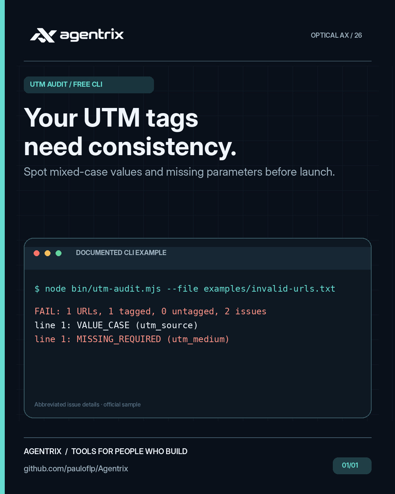
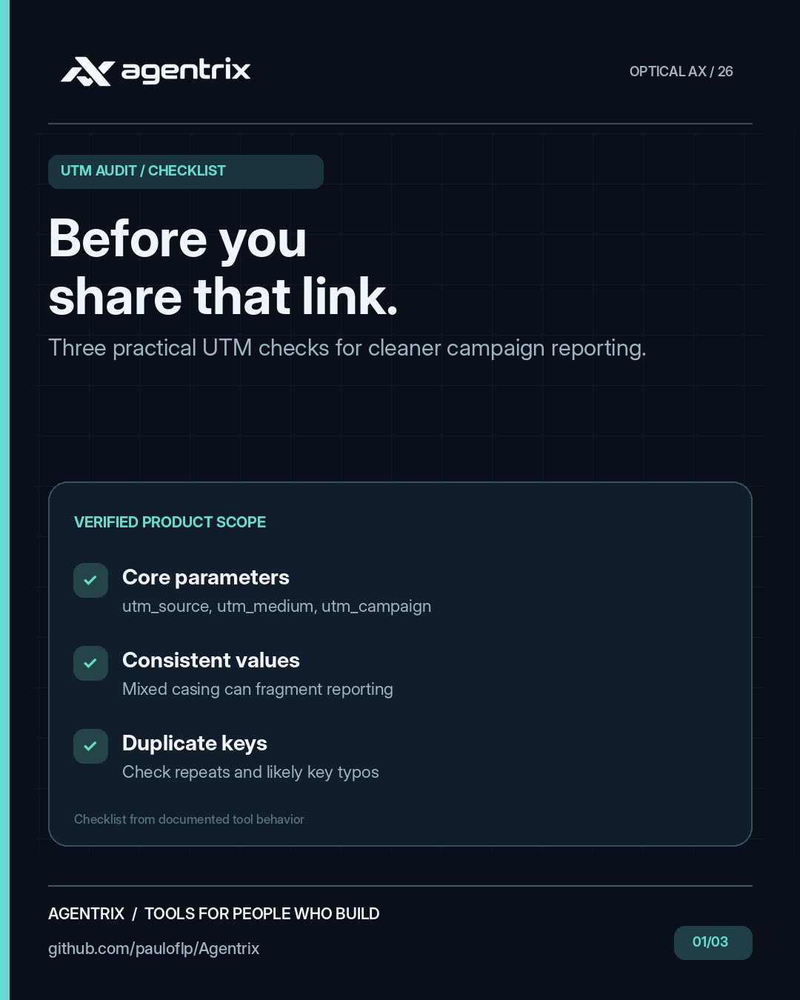
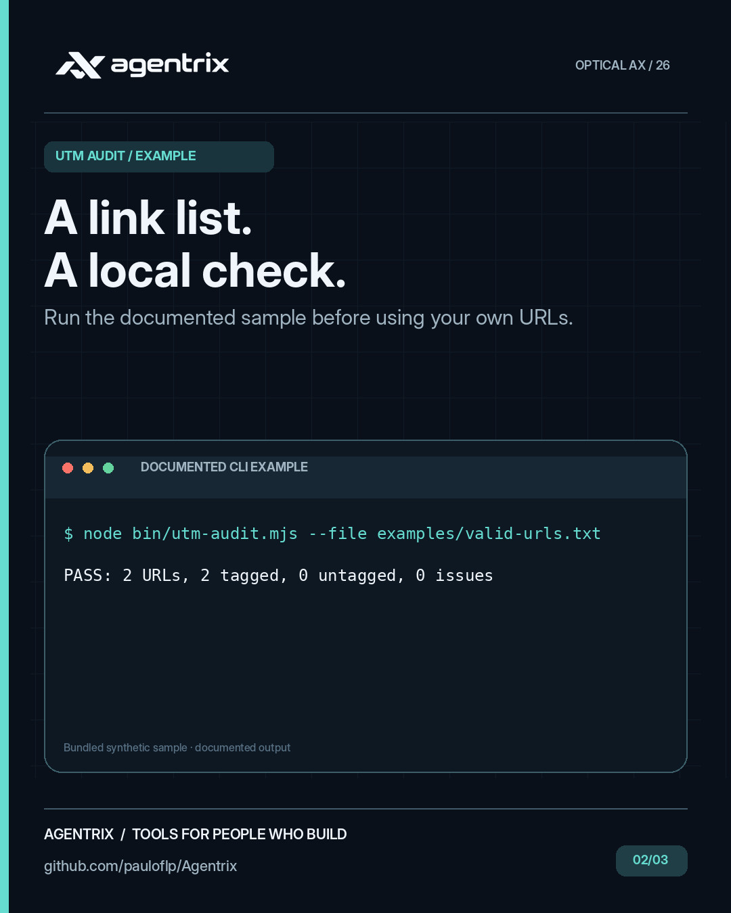
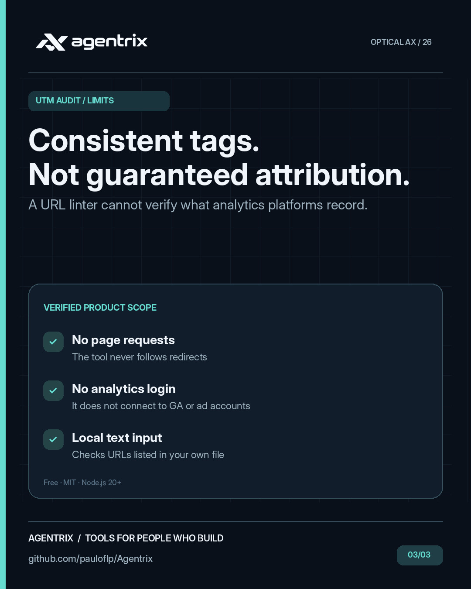

# Agentrix UTM Audit: campaign URL and UTM checker

**Find inconsistent campaign links before publishing ads, newsletters, or social posts.** A free, offline, zero-dependency Node.js CLI for checking UTM tagging across a plain-text list of URLs.

## UTM Audit at a glance

These campaign illustrations highlight the kinds of problems **UTM Audit** helps address. They are conceptual visuals rather than product screenshots. Follow the examples and documentation below to see what the tool actually does.

<p align="center"></p>

<details>
<summary>View 3 more campaign images</summary>

<p align="center">



</p>

</details>

## Quick start

Requires **Git and Node.js 20+**. Run from source with bundled synthetic links; no `npm install` or analytics account is needed:

```bash
git clone --depth 1 https://github.com/pauloflp/Agentrix.git
cd Agentrix/products/agentrix-utm-audit
node bin/utm-audit.mjs --file examples/valid-urls.txt
```

```text
PASS: 2 URLs, 2 tagged, 0 untagged, 0 issues
```

The [invalid example](examples/invalid-urls.txt) has an uppercase source value and no `utm_medium`:

```bash
node bin/utm-audit.mjs --file examples/invalid-urls.txt
```

```text
FAIL: 1 URLs, 1 tagged, 0 untagged, 2 issues
line 1: VALUE_CASE (utm_source): Mixed/uppercase value can fragment case-sensitive reporting
line 1: MISSING_REQUIRED (utm_medium): Recommended core UTM parameter is missing
```

The rejection intentionally exits `1`. The tool only parses links; it does not visit them. From the repository root, `node scripts/demo.mjs utm-audit` demonstrates both outcomes.

<div align="center">

<br/><sub>Agentrix workflow illustration. Commands and limitations below describe this specific tool.</sub>
</div>

## Why

Google Analytics recommends consistent `utm_source`, `utm_medium`, and `utm_campaign` parameters. Their **values are case-sensitive**, so inconsistent capitalization can fragment campaign reporting. This tool spots common tagging mistakes before links go live.

## Requirements

Node.js 20+. No dependencies, account, analytics access, or network requests.

## Usage

Create a UTF-8 file `urls.txt` with **one absolute URL per line**. Blank lines and lines starting with `#` are ignored.

```text
https://example.com/?utm_source=google&utm_medium=cpc&utm_campaign=launch
https://example.com/?utm_source=newsletter&utm_medium=email&utm_campaign=launch
```

Run from the product directory:

```bash
node bin/utm-audit.mjs --file urls.txt
node bin/utm-audit.mjs --file urls.txt --json
node bin/utm-audit.mjs --file urls.txt --allow-untagged
npm test
```

Exit codes: `0` no findings, `1` validation findings, `2` file or argument error. Reports **line numbers and issue codes, never full URLs or parameter values**.

## Checks

- Missing recommended core UTMs (`utm_source`, `utm_medium`, `utm_campaign`)
- Duplicate UTM keys, incorrect key capitalization, empty values, and likely key typos
- Uppercase/mixed-case values, whitespace, and capitalization conflicts across URLs
- Untagged links (unless explicitly allowed) and UTMs placed in URL fragments
- Malformed links and non-HTTP(S) URL schemes

## Limitations

- This is a **naming consistency linter**, not a guarantee that analytics tracking works or that channel attribution is correct.
- Uppercase and whitespace rules are opinionated style warnings; some naming conventions intentionally use them.
- Supports local text input up to 2 MiB / 10,000 lines. It does not fetch destination pages, follow redirects, or connect to Google Analytics.
- Dynamic advertising platform macros are not expanded; validate their eventual values separately.
- Reports avoid printing full links, but input files remain on your machine. Treat links containing private tokens as sensitive.

## Reference

[Google Analytics: Collect campaign data with custom URLs](https://support.google.com/analytics/answer/10917952)

## License

MIT. Free for personal and commercial use. [Agentrix](https://github.com/pauloflp/Agentrix).

## Related tools

If campaign data arrives as CSV, use [CSV Guard](../agentrix-csv-guard/) for structural checks or [Data Import Studio](../agentrix-data-import-studio/) for visual mapping and typed validation. [Browse all six tools](../../README.md#free-tools) or [ask a usage question](https://github.com/pauloflp/Agentrix/discussions).
